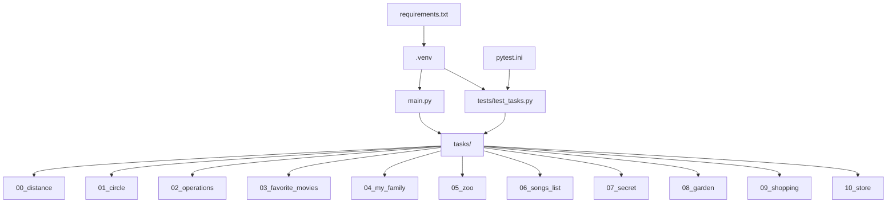

# Лабораторная работа по Python

Репозиторий с выполненными заданиями по дисциплине "Теория алгоритмов", 3 курс.

## Требования

```bash
Python 3.10+
pip 23.2.1+
```

## Установка

```bash
git clone https://github.com/HolograficDev/semester3_python_lab1.git
cd python-lab-1
python -m venv .venv
.venv\Scripts\activate
pip install -r requirements.txt
```
## Запуск

```bash
python main.py        # все задания подряд
pytest                # тесты
python tasks/05_zoo.py   # одно задание
```

## Структура

| Модуль | Задание |
|---|---|
| `00_distance` | расстояния между городами |
| `01_circle` | площадь круга, принадлежность точек |
| `02_operations` | формула из 1 2 3 4 5, равная 25 |
| `03_favorite_movies` | названия фильмов срезами строки |
| `04_my_family` | рост семьи |
| `05_zoo` | операции со списком животных |
| `06_songs_list` | время звучания песен |
| `07_secret` | расшифровка сообщения срезами |
| `08_garden` | множества цветов |
| `09_shopping` | две минимальные цены на сладости |
| `10_store` | стоимость товаров на складе |

## Архитектура проекта


